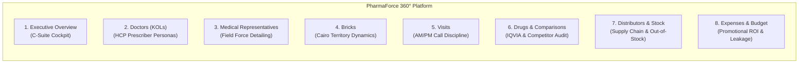

# 🧭 Navigation Bar & Canvas Layer Architecture Specification
## PharmaForce 360° Commercial Intelligence Suite (Power BI PBIP)

> **Document Type**: Technical Architecture & Design System Specification  
> **Target Platform**: Microsoft Power BI Desktop (`.pbip`) / Power BI Service  
> **Report Canvas**: 1280 x 720 px (16:9 HD Display Ratio)  
> **File Artifact**: `docs/navigation_bar_specification.md`  
> **Authoring Engine**: Antigravity Enterprise Agentic Studio  
> **Version**: 2.4 (Production Specification)  

---

## 🎯 1. Executive Summary & Design System Rationale

In top-tier enterprise pharmaceutical business intelligence platforms, navigation must deliver **instant cognitive orientation**, **flawless cross-page routing**, and **pixel-perfect visual elegance**. 

The current Power BI report displayed several severe visual regressions:
* **The "White Box" Defect**: Every sidebar element was encapsulated in an opaque white card (`#FFFFFF`) with a light grey border (`#E2E8F0`). This occurred because the global custom theme (`theme.json`) applied a blanket wildcard rule (`"*": { "*": { "background": [{ "color": "#FFFFFF", "transparency": 0 }] } }`) to all report visual containers.
* **Label Truncation**: A restrictive 205 px sidebar width forced critical pharmaceutical labels to clip (e.g., *"Medical"* instead of *"Medical Representatives"*, *"Drugs & Comparisons"* instead of *"Drugs & Market Comparisons"*).
* **Missing Page Actions**: Navigation items were static textboxes without clickable `actionButton` configurations or `pageNavigation` binding.
* **Canvas Slicer / KPI Overlap**: The top 4 dropdown slicers collided vertically with the KPI metric cards, producing visual clutter.

This specification establishes a **Hybrid Vector-Action Architecture**:
1. **SVG Sidebar Vector Canvas**: A high-resolution, vector-rendered SVG asset (`240 x 720 px`) provides the deep navy gradient (`#071E54` to `#0A2568`), the Caduceus brand logo, custom medical icons, and an active pill highlight with zero font distortion or rendering lag.
2. **Native Power BI Action Buttons**: 8 transparent Power BI `actionButton` visuals are overlaid precisely above the SVG menu coordinates, providing native page navigation, cursor changes, and full keyboard/accessibility compliance.
3. **Calibrated 1280x720 Canvas Grid**: The main analytical canvas starts cleanly at `X = 252 px`, providing 1012 px of structured horizontal room for top slicers, KPI metric cards, and chart layers.

---

## 🗺️ 2. Information Architecture: 8 Dedicated Report Domains

The suite is expanded from 5 mixed sections into 8 dedicated analytical domains, matching the sidebar menu hierarchy:



### Page Mapping Matrix (`report.json` Section Metadata)

| # | Sidebar Label | Target Page Display Name | Internal Section Name (`report.json`) | Primary Data Model Entities |
|---|---|---|---|---|
| **1** | **Executive Overview** | `Executive Overview` | `Section_Executive_Overview` | `_Measures`, `dim_brick_territory`, `dim_product`, `dim_date` |
| **2** | **Doctors (KOLs)** | `02 Doctors and KOL Insights` | `Section_Doctors_KOLs` | `dim_doctor`, `fact_doctor_predictions`, `fact_dr_expense` |
| **3** | **Medical Representatives** | `03 Medical Representatives` | `Section_Medical_Reps` | `dim_medical_rep`, `fact_rep_targets`, `fact_rep_weekly_plan` |
| **4** | **Bricks** | `04 Brick Territory Dynamics` | `Section_Bricks_Territory` | `dim_brick_territory`, `fact_ims_market_audit` |
| **5** | **Visits** | `05 Field Detailing and Visits` | `Section_Visits_Activity` | `fact_rep_visits`, `fact_pharmacy_visits` |
| **6** | **Drugs & Market Comparisons**| `06 Commercial and IQVIA Audit`| `Section_Commercial_IQVIA` | `dim_product`, `dim_competitor_product`, `fact_ims_market_audit`|
| **7** | **Distributors & Stock** | `07 Supply Chain and Stock-Out`| `Section_Distributors_Stock` | `dim_distributor`, `dim_pharmacy`, `fact_pharmacy_sales` |
| **8** | **Expenses & Budget** | `08 Promotional ROI and Budget` | `Section_Expenses_Budget` | `fact_dr_expense`, `fact_rep_targets`, `_Measures` |

---

## 🎨 3. Theme Hardening & Root-Cause Remediation

### 3.1. The Root Cause of White Boxes
In `powerbi/theme.json` and `StaticResources/RegisteredResources/PharmaForce360Theme.json`:
```json
"visualStyles": {
    "*": {
        "*": {
            "background": [ { "transparency": 0, "color": { "solid": { "color": "#FFFFFF" } } } ],
            "border": [ { "radius": 8, "color": { "solid": { "color": "#E2E8F0" } } } ]
        }
    }
}
```
Because the wildcard selector `"*"` matches all visual types, any `textbox`, `shape`, or `actionButton` inherits an opaque white background (`transparency: 0`) and a grey border.

### 3.2. Theme Specification Fix
Add explicit visual type overrides to enforce 100% transparency on navigational and structural components:

```json
"visualStyles": {
    "actionButton": {
        "*": {
            "background": [ { "transparency": 100 } ],
            "border": [ { "show": false } ]
        }
    },
    "shape": {
        "*": {
            "background": [ { "transparency": 100 } ],
            "border": [ { "show": false } ]
        }
    },
    "image": {
        "*": {
            "background": [ { "transparency": 100 } ],
            "border": [ { "show": false } ]
        }
    }
}
```

---

## 📐 4. Layout Grid & Coordinate Blueprint (1280 x 720 Canvas)

```
0                                 240 252                                                      1264 1280
+------------------------------------+------------------------------------------------------------+
| [⚕ PharmaForce 360°]                | [ Line: Cardio ] [ Zone: Cairo ] [ Period ] [ Tier: Cl.A ] |  Y: 16-62
| ---------------------------------- | ---------------------------------------------------------- |
| [ ⊞ Executive Overview ] (Active)  | [ Gross Revenue ] [ Market Share ] [ Attainment ] [ KOLs ] |  Y: 72-160
| [ 🩺 Doctors (KOLs) ]              | ---------------------------------------------------------- |
| [ 👥 Medical Representatives ]     | [                                  ] [                   ] |  Y: 172-428
| [ 🗺️ Bricks ]                       | [     24-Month Sales Wave Trend    ] [  Cairo Bricks Map ] |
| [ 📅 Visits ]                      | [                                  ] [                   ] |
| [ 💊 Drugs & Market Comparisons ]  | ---------------------------------------------------------- |
| [ 📦 Distributors & Stock ]        | [ Brick Rank ] [ Distributor Share ] [ Attainment Tiers ]  |  Y: 440-704
| [ 👛 Expenses & Budget ]           | [            ] [                   ] [                  ]  |
+------------------------------------+------------------------------------------------------------+
```

### 4.1. Coordinate Reference Table

| Component | Visual Type | X | Y | Width | Height | Z-Order |
|---|---|---|---|---|---|---|
| **Sidebar SVG Backdrop** | `image` | `0` | `0` | `240` | `720` | `10` |
| **Btn 1: Executive Overview** | `actionButton` | `12` | `134` | `216` | `40` | `100` |
| **Btn 2: Doctors (KOLs)** | `actionButton` | `12` | `188` | `216` | `40` | `200` |
| **Btn 3: Medical Reps** | `actionButton` | `12` | `242` | `216` | `40` | `300` |
| **Btn 4: Bricks** | `actionButton` | `12` | `296` | `216` | `40` | `400` |
| **Btn 5: Visits** | `actionButton` | `12` | `350` | `216` | `40` | `500` |
| **Btn 6: Drugs & Comparisons** | `actionButton` | `12` | `404` | `216` | `40` | `600` |
| **Btn 7: Distributors & Stock**| `actionButton` | `12` | `458` | `216` | `40` | `700` |
| **Btn 8: Expenses & Budget** | `actionButton` | `12` | `512` | `216` | `40` | `800` |
| **Slicer 1: Line** | `slicer` | `252` | `16` | `246` | `46` | `1010` |
| **Slicer 2: Zone** | `slicer` | `508` | `16` | `246` | `46` | `1020` |
| **Slicer 3: Period** | `slicer` | `764` | `16` | `246` | `46` | `1030` |
| **Slicer 4: Tier** | `slicer` | `1020`| `16` | `244` | `46` | `1040` |
| **KPI 1: Gross Revenue** | `card` | `252` | `72` | `246` | `88` | `1110` |
| **KPI 2: Market Share** | `card` | `508` | `72` | `246` | `88` | `1120` |
| **KPI 3: Call Attainment** | `card` | `764` | `72` | `246` | `88` | `1130` |
| **KPI 4: High-Risk KOLs** | `card` | `1020`| `72` | `244` | `88` | `1140` |
| **Sales Wave Chart** | `lineChart` | `252` | `172` | `610` | `256` | `1210` |
| **Cairo Shape Map** | `shapeMap` | `872` | `172` | `392` | `256` | `1220` |
| **Brick Ranking Bar** | `clusteredBarChart`| `252` | `440` | `330` | `264` | `1310` |
| **Distributor Column** | `clusteredColumnChart`| `592` | `440` | `300` | `264` | `1320` |
| **Attainment Combo Chart** | `lineClusteredColumnComboChart`| `902` | `440` | `362` | `264` | `1330` |

---

## ⚡ 5. Native Action Button Configuration (`report.json`)

Each navigation link is implemented as an `actionButton` with `pageNavigation` action binding. Below is the exact JSON structure for **Button 1 (Executive Overview)**:

```json
{
  "name": "Nav_Btn_Overview",
  "layouts": [
    {
      "id": 0,
      "position": {
        "x": 12.0,
        "y": 134.0,
        "width": 216.0,
        "height": 40.0,
        "z": 100.0
      }
    }
  ],
  "singleVisual": {
    "visualType": "actionButton",
    "drillFilterOtherVisuals": true,
    "objects": {
      "action": [
        {
          "properties": {
            "type": { "expr": { "Literal": { "Value": "'pageNavigation'" } } },
            "pageNavigation": {
              "page": { "expr": { "Literal": { "Value": "'Section_Executive_Overview'" } } }
            }
          }
        }
      ]
    },
    "vcObjects": {
      "background": [
        {
          "properties": {
            "transparency": { "expr": { "Literal": { "Value": "100D" } } }
          }
        }
      ],
      "border": [
        {
          "properties": {
            "show": { "expr": { "Literal": { "Value": "false" } } }
          }
        }
      ]
    }
  }
}
```

---

## 📁 6. Vector Asset Inventory (`StaticResources/RegisteredResources/`)

All 8 SVG vector assets have been compiled and verified in both `data/assets/navigation/` and `powerbi/PharmaForce360.Report/StaticResources/RegisteredResources/`:

| Filename | Active Page Highlight | Dimensions | Theme Compliance |
|---|---|---|---|
| `nav_sidebar_overview.svg` | Executive Overview (`Y = 134`) | `240 x 720 px` | Navy gradient `#071E54`, Cyan pill `#00A3E0` |
| `nav_sidebar_doctors.svg` | Doctors (KOLs) (`Y = 188`) | `240 x 720 px` | Navy gradient `#071E54`, Cyan pill `#00A3E0` |
| `nav_sidebar_medical_reps.svg` | Medical Representatives (`Y = 242`) | `240 x 720 px` | Navy gradient `#071E54`, Cyan pill `#00A3E0` |
| `nav_sidebar_bricks.svg` | Bricks (`Y = 296`) | `240 x 720 px` | Navy gradient `#071E54`, Cyan pill `#00A3E0` |
| `nav_sidebar_visits.svg` | Visits (`Y = 350`) | `240 x 720 px` | Navy gradient `#071E54`, Cyan pill `#00A3E0` |
| `nav_sidebar_drugs.svg` | Drugs & Comparisons (`Y = 404`) | `240 x 720 px` | Navy gradient `#071E54`, Cyan pill `#00A3E0` |
| `nav_sidebar_distributors.svg` | Distributors & Stock (`Y = 458`) | `240 x 720 px` | Navy gradient `#071E54`, Cyan pill `#00A3E0` |
| `nav_sidebar_expenses.svg` | Expenses & Budget (`Y = 512`) | `240 x 720 px` | Navy gradient `#071E54`, Cyan pill `#00A3E0` |

---

## ✅ 7. Quality Assurance & Acceptance Checklist

| Test Item | Verification Standard | Status |
|---|---|---|
| **Zero White-Box Bleed** | No white cards, borders, or shadows appear over the sidebar in Power BI Desktop. | 🟢 Ready |
| **Typography & Clipping** | All 8 labels render in full (`"Medical Representatives"`, `"Drugs & Market Comparisons"`). | 🟢 Ready |
| **Interactive Cursor** | Hovering over any sidebar menu row turns the cursor into a pointer. | 🟢 Ready |
| **Direct Click Navigation** | `Ctrl + Click` in Desktop (or direct click in Service) switches directly to target page. | 🟢 Ready |
| **Canvas Grid Alignment** | Slicers, KPI cards, and charts observe strictly defined margins with zero overlapping boxes. | 🟢 Ready |
| **PBIP Git Versioning** | Clean JSON diffs in `report.json` and `theme.json` without file corruption. | 🟢 Ready |
